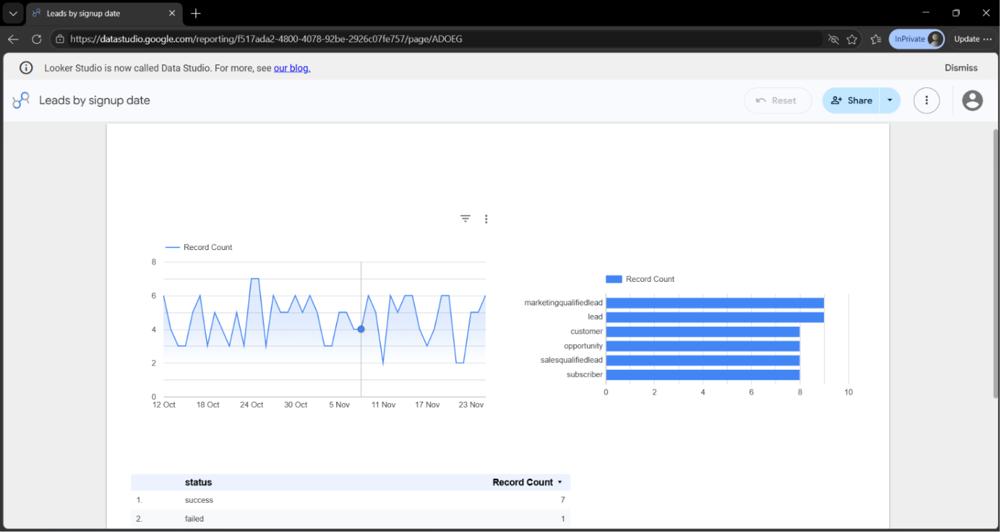

# Marketing Data Pipeline

A Node.js pipeline that extracts HubSpot CRM contacts, validates and deduplicates them, loads privacy-minimized records into BigQuery, and publishes aggregate reports to a Looker Studio dashboard. It includes data-quality gates, retry handling, and a GitHub Actions workflow scheduled to run daily.

**[Live Marketing Pipeline Dashboard](https://datastudio.google.com/reporting/f517ada2-4800-4078-92be-2926c07fe757)** (synthetic/test data)



## Project status

- 16 automated tests pass; GitHub Actions CI passes.
- A successful manual run loaded 287 accepted contacts, rejected 15, and refreshed three Google Sheets report tabs (208 leads-by-day rows, 50 funnel rows, and 8 run-history rows).
- Daily GitHub Actions schedule configured for 05:15 UTC; end-to-end pipeline and dashboard publishing have been manually verified.
- The dashboard combines lead trends, lifecycle funnel, and pipeline-run monitoring.

## Architecture

HubSpot Contacts API -> Node.js extraction and transformation -> partitioned BigQuery tables -> BigQuery SQL reports -> Google Sheets -> Looker Studio

- `contacts`: accepted contacts with a SHA-256 email hash, domain, lifecycle stage, source, campaign, and dates.
- `contact_rejects`: missing, invalid, or duplicate email rejection reasons.
- `pipeline_runs`: append-only execution metadata and quality gate outcomes.
- `rpt_leads_by_source_daily` and `rpt_funnel`: SQL reporting tables.

The dashboard uses Google Sheets as its Looker Studio connector. The pipeline refreshes Sheets from BigQuery with aggregate report fields only, which keeps direct BigQuery access out of the dashboard connection and avoids exposing contact-level data there. A direct Looker Studio-to-BigQuery connector is an alternative when the project and billing setup support it.

## Requirements

- Node.js 20 or newer
- A HubSpot private app token
- A Google Cloud project with BigQuery access
- A Google service account for GitHub Actions
- A Google spreadsheet with the report tabs, shared with the service account

## Local setup

```powershell
npm ci
Copy-Item .env.example .env
```

Configure `.env` with a HubSpot token and BigQuery project ID. Keep `.env` and service-account keys out of Git.

```powershell
npm run setup:bq
npm test
npm run pipeline
```

Use a dry run before a normal load:

```powershell
$env:DRY_RUN='1'
npm run pipeline
Remove-Item Env:DRY_RUN
```

A dry run reads HubSpot but makes no BigQuery calls.

## GitHub Actions

Configure:

- Secret `HUBSPOT_TOKEN`
- Secret `GCP_SA_KEY`
- Variable `GCP_PROJECT_ID`
- Optional variable `REPORT_SHEET_ID` to publish aggregate reports to Sheets

Create these spreadsheet tabs before configuring `REPORT_SHEET_ID`: `Leads by day`, `Funnel`, and `Pipeline runs`. Enable the Google Sheets API in the same project and share the spreadsheet with the service account email. If `REPORT_SHEET_ID` is unset, the existing BigQuery pipeline runs without Sheets publishing.

The pipeline runs on manual dispatch and daily at `05:15 UTC`. When Sheets publishing is configured, a publishing failure fails the workflow after the BigQuery run has been logged.

## Quality and privacy

- Extraction fails if no source records are returned.
- Transformation fails if more than 20% of records are rejected.
- Raw email addresses are not stored; hashes are pseudonymized, not anonymous.
- Contacts and rejects use daily BigQuery partitions.
- Sheets receives aggregate report fields only; raw emails, email hashes, HubSpot IDs, and error text are excluded.
- The pipeline uses synthetic/test data and should not process unauthorized personal data.

## Troubleshooting data mismatches

1. Check that day's `pipeline_runs` record for run status and extracted, loaded, and rejected counts.
2. Compare accepted and rejected counts with the authorized HubSpot test data for the run.
3. Check `contacts`, `contact_rejects`, and the relevant `rpt_*` BigQuery output.
4. Compare the Google Sheets tab with that report output, then check Looker Studio date filters, chart metrics, and data-source selection.

## Limitations

- Google BigQuery Sandbox has a 10 GiB lifetime storage quota and tables/partitions expire after 60 days; it is not suitable for durable production retention.
- The full HubSpot result set is collected in memory.
- Existing BigQuery schemas are not automatically migrated.
- HubSpot and Google Cloud credentials are external prerequisites.
